  <picture>
    <source media="(prefers-color-scheme: dark)" srcset="assets/header.svg">
    <source media="(prefers-color-scheme: light)" srcset="assets/header-light.svg">
    
  </picture>

  
  
  
  

## 👋 About me

- 🎓 Studying Artificial Intelligence at Technische Hochschule Deggendorf (THD) since October 2026
- 🧱 I like building software from the data structure up: trees, graphs and algorithms in C++
- 🌐 I turn analysis into interactive web dashboards with JavaScript and Chart.js
- 📊 For data I use Python, pandas, Power BI and Excel
- 🎥 I run **Hussein 2 Germany**, videos in Egyptian Arabic about studying and living in Germany

## 🚀 Projects

Click a project to open it. Each preview is animated; click it to go to the project.

<b>🎓 EDUFLOW</b> · personalized learning path generator

 

Scores courses for each student, orders them by prerequisites and builds a weekly schedule. Student, admin and counselor interfaces, with data saved to files.

`C++` `AVL tree` `BST` `graph` `depth-limited search`

**[Open the repository →](https://github.com/HusseinHany/EDUFLOW)**

<b>📚 Student Management System</b> · sorting algorithms, measured

 

A student grade system that compares five sorting algorithms on up to 100,000 records, counting comparisons and swaps, with search, statistics and an AVL tree.

`C++` `sorting` `searching` `AVL tree` `benchmarks`

**[Open the repository →](https://github.com/HusseinHany/Student-Management-System)**

<b>🏦 Bank System</b> · roles, transfers and a class hierarchy

 

A console banking system where admins manage employees, employees open client accounts, and clients deposit, withdraw and transfer money. Client, Employee and Admin inherit from a shared Person class; passwords are hashed and every action is logged.

`C++` `OOP` `inheritance` `file I/O`

**[Open the repository →](https://github.com/HusseinHany/Bank_System)**

<b>📊 Data Analysis Project</b> · graduation project

 

Cleaning banking and customer data with pandas, documented step by step, with a Power BI report and a web dashboard.

`Python` `pandas` `Jupyter` `Power BI`

**[Live dashboard →](https://husseinhany.github.io/Data-Analysis-Project/)** · **[Open the repository →](https://github.com/HusseinHany/Data-Analysis-Project)**

<b>📈 Sales Analytics</b> · Excel and a live dashboard

 

Two datasets analysed in Excel and rebuilt as an interactive web dashboard: Northwind orders 1996–1998 ($1.27M) and Candy Line sales 2003–2005 ($10.03M). Filter by year, region or product line and click any bar to drill down.

`Excel` `pivot tables` `JavaScript` `Chart.js` `Python`

**[Live dashboard →](https://husseinhany.github.io/Sales/)** · **[Open the repository →](https://github.com/HusseinHany/Sales)**

<b>🔐 Escape Room Management System</b> · desktop app

 

A desktop app for an escape room business: themed rooms, bookings with filters, revenue reports and a customer leaderboard. I designed and built it from A to Z, from the database to every screen.

`C#` `Windows Forms` `SQL Server`

**[Open the repository →](https://github.com/HusseinHany/EscapeRoomBookingSystem)**

<b>🌐 Portfolio site</b> · live at husseinhany.github.io

 

My personal site, built without a framework, with light and dark mode and scroll animations.

`HTML` `CSS` `JavaScript` `GSAP`

**[Visit the site →](https://husseinhany.github.io)** · **[Open the repository →](https://github.com/HusseinHany/HusseinHany.github.io)**

## 🧰 Tools I use

  
  
  
  
  
  
  
  
  
  
  
  

## 📫 Get in touch

hussein27007@gmail.com · [LinkedIn](https://www.linkedin.com/in/husseindarwesh) · [Portfolio](https://husseinhany.github.io)

  

